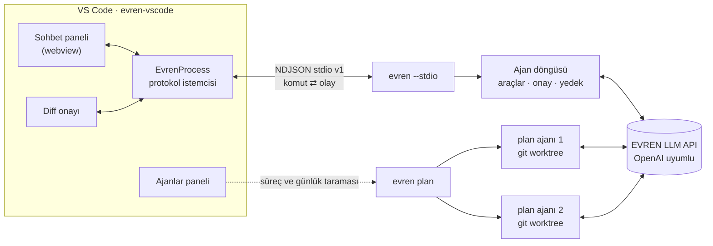

<div align="center">


# EVREN CLI

**Terminalde, editörde ve paralel plan ajanlarında çalışan Türkçe otonom yazılım geliştirme asistanı.**

[](https://github.com/necmettincimen/evren-cli/actions/workflows/ci.yml)
[](https://github.com/necmettincimen/evren-cli/releases)
[](https://sonarcloud.io/summary/new_code?id=necmettincimen_evren-cli)
[](https://github.com/necmettincimen/evren-cli/actions/workflows/codeql.yml)
[](https://scorecard.dev/viewer/?uri=github.com/necmettincimen/evren-cli)
[](LICENSE)


[Hızlı başlangıç](#-hızlı-başlangıç-windows-powershell) ·
[VS Code eklentisi](https://github.com/necmettincimen/evren-vscode) ·
[stdio protokolü](docs/stdio-protocol.md) ·
[Değişiklikler](CHANGELOG.md) ·
[English](#english-summary)

</div>

> **EVREN LLM API** (`https://evren-llmapi.ssyz.org.tr/v1`) ve OpenAI uyumlu uç noktalarla çalışır.
> Dosyaları okur, cerrahi düzenleme yapar, komut çalıştırır, testleri doğrular. Her değişiklik
> önce diff ile gösterilir, onay alınır ve yedeklenir.

<!-- Ekran görüntüsü / GIF: docs/assets/demo.gif eklendiğinde aşağıdaki satırı açın. -->
<!-- <p align="center"></p> -->

| | |
|---|---|
| 🤖 **Otonom ajan döngüsü** | Plan → oku → düzenle → çalıştır → doğrula; adım bütçesi, kesilme kurtarma |
| 🧭 **Plan ajanları** | `evren plan` ile JSON planındaki adımları worktree'lerde paralel ajanlara dağıtır |
| 🧩 **Editör entegrasyonu** | `evren --stdio` NDJSON protokolü v1 ve [VS Code eklentisi](https://github.com/necmettincimen/evren-vscode) |
| 🛡️ **Güvenli varsayılanlar** | Çalışma alanı sınırı, onay, otomatik yedek, `/undo`, sır maskeleme |
| 🔌 **SSH ve beceriler** | Uzak sunucu araçları, kalıcı hafıza, playbook ve beceri dosyaları |
| 🧪 **LLM'siz testler** | Sahte model sunucusuyla uçtan uca protokol testleri, Ubuntu + Windows CI |

---

## 🌟 Öne Çıkan Özellikler

1. **EVREN TUI ve Slash Komutları (`/`):**
   - `/help`, `/version`, `/model`, `/models`, `/quota`, `/terms`, `/scan`, `/files`, `/add`, `/drop`, `/undo`, `/run`, `/update`, `/clear`, `/exit`.
   - Zengin terminal arayüzü (`rich` panelleri, sözdizimi vurgulamalı markdown, diff tabloları).

2. **Sürüm Yönetimi ve Sürüm Notları:**
   - Tek kaynaklı sürüm (`src/version.py`), `pyproject.toml`'dan otomatik okunur.
   - `evren --version` / `-V` bayrağı ve `/version` slash komutu.
   - Açılış banner'ında sürüm numarası ve `CHANGELOG.md`'den çekilen sürüm notları gösterilir.

3. **Otonom Ajan Döngüsü (Agentic Loop):**
   - Kullanıcının verdiği çok adımlı geliştirme veya hata ayıklama görevini kendi başına analiz eder.
   - Dosyaları `view_file` ile okur, `edit_file` ile cerrahi blok değişiklikleri yapar, `write_file` ile yeni dosyalar üretir, `run_command` ile testleri çalıştırır.
   - Karmaşık işler için 3–7 kısa alt adım ve her turda tek doğrulanabilir adım talimatı verilir; bağımlı işlemler araç sonucundan sonra yürütülür.
   - “Bu host”, “bu hosts”, “bu makine” ve “localhost” yerel hedef olarak tanımlanır. SSH yalnızca açık uzak hedef istekleri içindir; önceki SSH işlemi sonraki isteğin varsayılan hedefini değiştirmez.
   - Gerçek işletim sistemi, kabuk ve çalışma dizini modele aktarılır. `run_command` CLI'nin çalıştığı makinede çalışır; Windows'ta varsayılan kabuk cmd.exe, PowerShell için açık çağrı gerekir.
   - Token sınırında kesilen veya boş yanıt bir kez küçük adıma yönlendirilir. İkinci ardışık kesilme/boş yanıt veya adım sınırı açık “görev tamamlanmadı” hatası üretir; yarım araç çağrıları çalıştırılmaz.

4. **EVREN LLM API Entegrasyonu:**
   - OpenAI SDK ve HTTP/SSE uyumluluğu.
   - **Kullanım Şartları (Terms):** İlk çalıştırmada `/v1/terms/status` kontrolü ve etkileşimli şart onaylama akışı.
   - **Keep-Alive Filtreleme:** Sunucunun 10 saniyede bir gönderdiği `: keep-alive` SSE satırlarını filtreler.
   - **Düşünme (Reasoning) Desteği:** `deepseek-v4.1-flash`, `glm-5.3` ve `qwen` modellerinin `reasoning` / `reasoning_content` zincirini terminalde ayrı renkle canlı akıtır.
   - **Kota ve Token Takibi:** `x-evren-daily-remaining-tokens` başlığı ve `/v1/quota` uç noktası üzerinden kalan kotayı anlık izler.

5. **Windows Geliştirici Güvenliği:**
   - **Dizin Sınırı (Boundary Check):** Asistan yalnızca belirlenen çalışma alanı kökü içinde dosya okur ve yazar; dışarı sızamaz.
   - **Otomatik Yedekleme:** Değiştirilen her dosya `.evren/backups/` altında zaman damgasıyla yedeklenir.
   - **Rollback Desteği:** `/undo <dosya>` veya `evren rollback <dosya>` ile tek tuşla önceki sürüme dönülür.
   - **Renkli Diff Önizleme:** Değişiklikler uygulanmadan önce yeşil `+` ve kırmızı `-` satırlarıyla kullanıcıya gösterilir ve onay istenir.

---

## 🧩 Editör Entegrasyonu: `evren --stdio`

`evren --stdio`, editör eklentileri için uzun ömürlü bir NDJSON süreci başlatır. Her satır bir
JSON mesajıdır: stdin'e komutlar, stdout'a olaylar yazılır. Diğer tüm çıktılar stderr'e gider.
Protokolün tamamı [docs/stdio-protocol.md](docs/stdio-protocol.md) belgesinde, makine tarafından okunabilen sözleşme ise
[`protocol/stdio-v1.schema.json`](protocol/stdio-v1.schema.json) (JSON Schema 2020-12) dosyasındadır.



### Uyumluluk ve sürüm politikası

| evren-vscode | En düşük evren-cli | stdio protokolü |
|---|---|---|
| 0.1.x | 3.10.0 | v1 |

- **Protokol sürümü** (`v` alanı, `ready.protocol`) yalnız geriye uyumsuz değişiklikte artar.
  Yeni komut, olay ya da isteğe bağlı alan eklemek v1 içinde kalır. İstemciler tanımadıkları olayları atlar.
- **CLI sürümü** SemVer kullanır. Eklenti `ready.version` değerini kendi `MIN_CLI_VERSION` değeriyle karşılaştırır; eski CLI'da güncelleme ister.
- Şema her release'e eklenir. evren-vscode CI'ı şemayı ve sahte sunucuyu `protocol/CLI_TAG` etiketinden indirip
  sözleşme testi ile gerçek CLI'a karşı Ubuntu ve Windows'ta uyumluluk testi koşturur. Her evren-cli release'i bu işi
  `repository_dispatch` ile yeniden tetikler.

---

## 🚀 Hızlı Başlangıç (Windows PowerShell)

### 1. Kurulum Betiğini Çalıştırın

```powershell
cd C:\Projeler\evren-cli
powershell -ExecutionPolicy Bypass -File .\scripts\install.ps1
```

Veya elle kurmak isterseniz:

```powershell
python -m venv .venv
.\.venv\Scripts\Activate.ps1
pip install -r requirements.txt
pip install -e .
copy .env.example .env
```

### 2. `.env` Dosyanızı Düzenleyin

```env
EVREN_API_KEY=evren_llm_gercek_anahtariniz_buraya
EVREN_BASE_URL=https://evren-llmapi.ssyz.org.tr/v1
EVREN_DEFAULT_MODEL=mimo-v2.6-pro
EVREN_DEFAULT_MAX_TOKENS=4096
```

**Kabuk:** Windows'ta Git for Windows kuruluysa ajanın `run_command` komutları **Git Bash** ile
çalışır (POSIX: `grep`, `sed`, `find`, `head`, `tail`, çok satırlı betik). Bulunamazsa `cmd.exe`
kullanılır. Elle seçmek için `EVREN_SHELL=bash|cmd|powershell`, bash yolunu vermek için
`EVREN_GIT_BASH=C:\Program Files\Git\bin\bash.exe`. EVREN'i Git Bash terminalinden çalıştırmak önerilir.

### 3. Asistanı Başlatın

```powershell
.\.venv\Scripts\Activate.ps1
evren
```

---

## 🌍 Sistem Geneli (Global) Kurulum — Her Dizinden `evren`

Proje klasörüne girmeden, **terminali hangi dizinde açarsanız açın** sadece `evren`
yazarak o dizinde otonom ajanı başlatmak için global kurulum betiğini kullanın.

### Tek Komutla Global Kurulum

```powershell
cd C:\Projeler\evren-cli
powershell -ExecutionPolicy Bypass -File .\scripts\install-global.ps1
```

Bu betik şunları yapar:

1. Python sürümünü doğrular.
2. `evren-cli` paketini **global Python ortamına** (editable) kurar → `evren` komutu oluşur.
3. Python `Scripts` klasörünü kullanıcı `PATH`'ine ekler (gerekiyorsa).
4. `.env` dosyası yoksa `.env.example`'dan oluşturur.
5. Komutun erişilebilir olduğunu doğrular.

> **Not:** PATH değişikliğinin geçerli olması için kurulumdan sonra **yeni bir terminal**
> açmanız gerekir.

### Global Kurulumu Test Etme

Yeni bir terminal açın ve herhangi bir proje dizinine gidip çalıştırın:

```powershell
cd C:\Projeler\BenimProjem
evren
```

Ajan, **bulunduğunuz dizini otomatik olarak çalışma alanı** kabul eder ve o dizinde
çalışmaya başlar. Farklı bir dizini hedeflemek isterseniz:

```powershell
evren --workspace C:\Baska\Dizin
```

### Global Kurulumu Kaldırma

```powershell
powershell -ExecutionPolicy Bypass -File .\scripts\install-global.ps1 -Uninstall
```

### Alternatif: Sanal Ortama Global Kurulum

Global Python ortamını kirletmek istemezseniz, komutu proje `.venv`'ine kurup
`.venv\Scripts` klasörünü PATH'e ekleyebilirsiniz:

```powershell
powershell -ExecutionPolicy Bypass -File .\scripts\install-global.ps1 -Venv
```

---

## 💻 Kullanım Biçimleri

Mevcut göreve “yap artık”, “uygula” veya “hepsine onay veriyorum” yanıtı
verdiğinizde yeni Brief/form hazırlığı yapılmaz; yanıt mevcut görev geçmişine
aktarılır. Diğer takip yanıtları için `/execute <yanıt>` kullanabilirsiniz.
Önceki görev yoksa açık uyarı verilir. Bu kısa yol otomatik onayı açmaz,
salt-okuma/plan kipini veya SSH yazma izinlerini değiştirmez.
Netleştirme sorusunun yanıtına “yap artık”, “soru sorma” veya “devam”
yazarsanız kalan form/öneri adımları atlanır; mevcut Brief ve önceki yanıtlar
korunarak önce salt-okuma keşfine geçilir. Eksik mimari kararlar uydurulmaz.

Ajan adım sınırında durduğunda Brief satırına `devam` veya `/continue` yazın.
Form ve netleştirme tekrarlanmaz; mevcut sohbet/araç sonuçları ve görev kipi
korunarak yeni 30 adımlık bütçe başlatılır. Her yeni sınırda tekrar devam
edebilirsiniz. `/clear` veya yeni görev bu devam durumunu temizler.
Adım sınırında kalıcı checkpoint kaydı için ayrıca onay istenir (otomatik onay
ayarından bağımsız). Kayıt yaptıysanız sonraki oturumda `/continue` yükleme
onayı ister; salt-okuma/plan kipi ve araç geçmişi korunur. Yükleme tek başına
eski araç çağrılarını çalıştırmaz. `/checkpoint` kayıt bilgisini gösterir,
`/checkpoint save` onayla kaydeder, `/checkpoint clear` onayla siler.
Checkpoint yerel `.evren/checkpoint.json` dosyasında tutulur; sistem promptu
yeni kurulumdan oluşturulur. URL parolaları, yaygın secret/token alanları ve
özel anahtar blokları maskelenir. Bu filtre tam gizlilik garantisi değildir:
hassas görevlerde kaydı reddedin; maskelenen kimlik bilgilerini güvenli yoldan
yeniden sağlayın. Dosya şifrelenmez; Windows erişimi dizin ACL'lerine bağlıdır.

`evren update` güncellemeyi bir kez yapar ve ardından etkileşimli CLI'ı açar;
yeniden başlatmada `update` komutu tekrar çalıştırılmaz. Çalışma dizini,
`--workspace` ve `--model` seçenekleri korunur. Yeniden başlatmadan yalnızca
güncellemek için `evren update --no-restart` kullanabilirsiniz.

### A. Etkileşimli EVREN TUI Modu

Herhangi bir argüman vermeden çalıştırdığınızda doğrudan etkileşimli terminal asistanı açılır:

```powershell
evren
```

Etkileşimli kalıpta önce **Brief** yazılır. Yeni Brief, önceki turun Rol,
Çerçeve, Kısıt ve Çıktı alanlarını temizler; Brief'te Enter önceki kalıbı korur.
Model önce gerçek belirsizlikleri tek tek sorar (en fazla üç soru), ardından
boş alanları Brief ve netleştirme yanıtlarına göre önerir.
Aynı soru tekrarlandığında veya üç soru sonunda belirsizlik sürdüğünde yanıtlar
atılmaz: asıl hedefi düzeltebilir, `devam` ile önce salt-okuma keşfini seçebilir
veya `iptal` yazabilirsiniz. Çözülemeyen sorular ve son hedef açıklaması görevle
birlikte aktarılır; mimari ve izinler netleşmeden riskli değişiklik yapılmaması istenir.
Uzun netleştirme soruları ve öneriler giriş satırından ayrı, terminal genişliğine
göre sarılarak gösterilir; yanıt yazarken metnin tamamı görünür kalır. Sorular
varsayılan koyu temada camgöbeği, öneriler yeşil, karar uyarıları sarı panellerde
gösterilir; giriş etiketleri de aynı renkle vurgulanır. Beyaz/açık terminal için
`.env` dosyasında `EVREN_UI_THEME=light` seçin; form koyu mavi, koyu yeşil ve
koyu turuncu kullanır. `dark` varsayılandır; arka plan otomatik tahmin edilmez
ve terminalin arka planı değiştirilmez. Bu ayar form panelleri ve giriş
etiketleri içindir. Rich yoksa düz metin kullanılır. Her alan için
**Enter** öneriyi kabul eder, yazdığınız metin önerinin yerine geçer,
**`-`** alanı boş bırakır. Dolu alanlara öneri uygulanmaz.
Netleştirme yanıtları görevle birlikte gönderilir; hazırlık sırasında araç veya
terminal komutu çalıştırılmaz. API/yanıt hatasında görev başlatılmaz.
Slash komutlarını ilk **Brief** satırına yazabilirsiniz. Tek seferlik
`evren agent --brief ...` kullanımı bu etkileşimli öneri akışını başlatmaz.

```text
═════════════════════════════════════════════════════════════════
✦ EVREN CLI v0.1.0 • AI Development & Project Assistant
Model: deepseek-v4.1-flash   Çalışma Alanı: C:\Projeler\MyProject
Kalan Günlük Kota: 980,240

v0.1.0 Sürüm Notları:
  • İnteraktif TUI (REPL) modu ve scriptlenebilir alt komutlar.
  • EVREN LLM API istemcisi: sohbet, akışlı (streaming) yanıt ve akıl yürütme desteği.
═════════════════════════════════════════════════════════════════

evren [deepseek-v4.1-flash] > /scan
evren [deepseek-v4.1-flash] > src/api_client.py dosyasını incele ve timeout süresini artır
evren [deepseek-v4.1-flash] > pytest ile testleri çalıştır
```

### B. Tek Seferlik Komut Satırı Modu

```powershell
# Hızlı soru-cevap ve streaming
evren chat "FastAPI ile asenkron endpoint nasıl tanımlanır?" --stream

# Belirli bir dosya bağlamıyla analiz
evren chat "Bu kodda güvenlik açığı var mı?" -f src/api_client.py

# Tek komutla otonom ajan görevi
evren agent "tests/ klasöründeki testleri çalıştır ve eksik testleri ekle"

# Beş satırlık kalıp: Rol/Çerçeve system'e, Brief/Kısıt/Çıktı user'a gider
evren agent --rol "kıdemli Windows mühendisi" --cerceve "cerrahi yama, mevcut stili koru" --brief "timeout süresini 45 saniyeye çıkar" --kisit "yalnız src/api_client.py" --cikti "çalışan kod ve pytest"

# Çalışma alanı dosya ağacı
evren scan

# Kalan token kotası
evren quota

# Kullanım şartlarını denetle/onayla
evren terms

# Değiştirilen dosyayı geri yükle
evren rollback src/api_client.py

# Sürüm bilgisini göster
evren --version
```

---

## 🛠️ Slash Komutları Tablosu

| Komut | Açıklama |
|---|---|
| `/help` | Kullanılabilir tüm slash komutlarını ve ipuçlarını listeler |
| `/version` | Sürüm numarasını ve `CHANGELOG.md`'den çekilen sürüm notlarını gösterir |
| `/model <ad>` | Aktif modeli anında değiştirir (örn: `/model glm-5.3`) |
| `/models` | EVREN API'deki tüm modelleri dinamik olarak çeker |
| `/quota` | Günlük kalan token kotasını gösterir |
| `/terms` | Kullanım şartlarının durumunu denetler ve onaylatır |
| `/skills [kategori]` | Kullanılabilir mühendislik becerilerini listeler |
| `/docs [alt komut]` | `agent.md` / `changelog.md` bağlam dosyaları: `status`\|`refresh [--adopt]`\|`unmark`\|`path` |
| `/apply <beceri>` | Bir beceriyi mevcut göreve uygular (örn: `/apply root-cause-debug`) |
| `/diagnose [ad]` | Arıza triyajı çalıştırır (örn: `/diagnose build-failure`) |
| `/template [ad]` | Çıktı şablonunu doldurur (örn: `/template adr`) |
| `/memory` | Proje hafızasını (profil + notlar) gösterir |
| `/memory set <k> <v>` | Profil alanı kaydeder (örn: `/memory set stack FastAPI`) |
| `/memory note <metin>` | Hafızaya not ekler |
| `/track [filtre]` | Görevleri listeler (all\|open\|<durum>) |
| `/task add <id> <açıklama>` | Yeni takip görevi ekler |
| `/progress <id> <yüzde>` | Görev ilerlemesini günceller |
| `/playbook [ad]` | Playbook'ları listeler veya başlatır |
| `/resume` | Kaydedilmiş playbook adımından devam eder |
| `/language [ad]` | Çıktı dilini ayarlar (örn: `/language tr`) |
| `/scan [yol]` | Çalışma alanını tarar, ASCII ağaç ve uzantı analizi sunar |
| `/files` | İstem bağlamına eklenmiş dosyaları listeler |
| `/add <dosya>` | Bir dosyayı aktif bağlama ekler |
| `/drop <dosya>` | Bir dosyayı aktif bağlamdan çıkarır |
| `/undo <dosya>` | `.evren/backups` klasöründeki son yedeğe geri döner |
| `/run <komut>` | Onay alarak PowerShell terminal komutu çalıştırır |
| `/ssh` | Kayıtlı SSH host'larını listeler |
| `/ssh add <alias> <user@host> [port]` | Yeni bir SSH host'u tanımlar |
| `/ssh remove <alias>` | Kayıtlı SSH host'unu siler |
| `/ssh test <alias>` | SSH bağlantısını test eder |
| `/update` | En son sürümü GitHub'dan çeker ve CLI'ı yeniden başlatır |
| `/clear` | Sohbet ve bağlam geçmişini sıfırlar |
| `/exit` | Uygulamadan güvenli şekilde çıkar |

---

## 🔐 SSH ile Uzak Sunucu İşlemleri

EVREN CLI, kayıtlı uzak sunucularda (host alias'ları üzerinden) komut çalıştırabilir,
dosya okuyabilir ve yazabilir. Güvenlik için **yalnızca önceden tanımlı alias'lara**
bağlanılır; rastgele host/IP kullanılamaz.

### Host Tanımlama

Host'lar `~/.evren/ssh_hosts.json` (veya çalışma alanındaki `.evren/ssh_hosts.json`)
dosyasında tutulur:

```json
{
  "prod-web": {
    "host": "10.0.0.5",
    "user": "deploy",
    "port": 22,
    "identity_file": "C:\\Users\\me\\.ssh\\id_ed25519",
    "description": "Üretim web sunucusu",
    "allow_write": false
  }
}
```

> `allow_write` varsayılan olarak `false`'tur; uzak yazma host başına bilinçli olarak açılır.

### REPL İçinden

```text
evren [deepseek-v4.1-flash] > /ssh add prod-web deploy@10.0.0.5 22
evren [deepseek-v4.1-flash] > /ssh test prod-web
evren [deepseek-v4.1-flash] > prod-web sunucusunda nginx durumunu kontrol et
```

### Komut Satırından

```powershell
evren ssh list
evren ssh add prod-web deploy@10.0.0.5 --port 22
evren ssh test prod-web
evren ssh run prod-web "systemctl status nginx"
```

### Güvenlik Modeli

- **Yalnızca alias'lı host'lar:** Rastgele hedefe bağlanma engellenir.
- **Anahtar/agent tabanlı auth:** `BatchMode=yes` ile parola prompt'unda takılma olmaz.
- **Mod geçidi:** `ssh_read_file`/`ssh_list_hosts` salt-okuma (her modda); `ssh_write_file` yazma (ask/plan'da reddedilir); `ssh_run` ask/plan'da yalnızca salt-okuma komutlarıyla sınırlı.
- **Onay akışı:** Her uzak komut/yazma öncesi kullanıcıdan onay istenir (`EVREN_AUTO_APPROVE=false` iken).
- **Denetim günlüğü:** Tüm uzak işlemler `.evren/logs/ssh_audit.log` dosyasına kaydedilir.
- **Injection koruması:** Uzak yazma içeriği stdin üzerinden gönderilir; shell tarafından yorumlanmaz.

> **Not:** Windows'ta `ssh` istemcisinin kurulu olması gerekir (Ayarlar → Uygulamalar →
> İsteğe Bağlı Özellikler → OpenSSH Client).

---

## 🧩 Beceriler, Hafıza, Takip ve Playbook'lar

Foreman'dan uyarlanan dört çekirdek yetenek, ajanı tek seferlik bir sohbetten
kalıcı bir geliştirme ortağına dönüştürür:

- **Beceriler (`/skills`, `/apply`):** Kök neden hata ayıklama, cerrahi refactor,
  TDD, API entegrasyonu, güvenlik incelemesi, performans, kod incelemesi ve
  bağımlılık güncelleme gibi yeniden kullanılabilir mühendislik reçeteleri.
  `/apply root-cause-debug` gibi bir komut, ilgili adımları ajan turuna enjekte eder.
- **Proje hafızası (`/memory`):** `.evren/memory.json` altında profil (stack, dil,
  konvansiyonlar, hedef) ve notlar saklanır; her oturumda sistem istemine eklenir.
- **Uygulama takibi (`/track`, `/task`, `/progress`):** `.evren/tasks.json` altında
  altı durumlu görevler; öneri ile gerçekleşen iş arasındaki boşluğu kapatır.
  `/blockers` engellenmiş veya 14 gündür ilerlemeyen işleri, kayıtlı kanıt ve çözüm
  yönlendirmesiyle gösterir. `/blockers add <id> <kategori> <kanıt>` ve
  `/blockers resolve <id> <not>` onayla kayıt değiştirir. Kategoriler:
  `dns`, `auth`, `dependency`, `knowledge`, `external`, `permission`.
  Nedenler otomatik tahmin edilmez; onaylı görev kayıtlarından okunur.
- **Gözden geçirme (`/check-in`):** Açık, gecikmiş ve 14 gündür duraklamış görevleri
  gösterir. `/check-in update` her görev için durum, ilerleme ve not sorar;
  değişiklikleri ayrı onayla kaydeder.
- **Karar günlüğü (`/decisions`):** `/decisions add` karar, gerekçe ve risk/sınır
  sorar; onayla `.evren/decisions.json` dosyasına kaydeder. Son 10 karar ajan
  bağlamına eklenir; bunlar geçmiş bilgidir, yürütme izni değildir. Karar kaydı
  mevcut Rol/Çerçeve alanlarını silmez.
- **Playbook'lar (`/playbook`, `/resume`):** Release, hotfix, onboarding ve migration
  gibi çok adımlı reçeteler; `.evren/playbook.json` checkpoint'i ile kaldığı yerden devam.
- **Dil modu (`/language`):** Kod İngilizce kalır, kullanıcıya dönük düzyazı seçilen
  dilde üretilir (örn: `/language tr`).
- **Arıza triyajları (`/diagnose`):** Derleme hatası, kararsız test, performans
  gerilemesi, bağımlılık çıkmazı, güvenlik açığı ve dağıtım hatası için
  yapılandırılmış triyaj; belirtiye göre otomatik eşleştirme.
- **Çıktı şablonları (`/template`):** Postmortem, ADR, PR açıklaması, sürüm notları,
  runbook ve hata raporu iskeletleri; ajan bunları eksiksiz doldurur.

---

## 🗂️ Akıllı Bağlam Dosyaları (`agent.md` / `changelog.md` / `skills.md`)

CLI her çalıştığında iki katmanda bağlam dosyası üretir ve **prompt API'ye gitmeden önce**
bunları okuyup ajan sistem istemine ekler; böylece netleştirme soruları ve adım önerileri
projeyi bilerek üretilir.

| Dosya | Konum | İçerik |
|---|---|---|
| `agent.md` | çalışılan proje dizini | ortam, proje haritası, konvansiyonlar, son görev |
| `changelog.md` | çalışılan proje dizini | oturum/görev bazlı **append-only** değişiklik günlüğü |
| `skills.md` | CLI ana dizini | beceri kataloğu + `## Özel Beceriler` (yalnızca size ait) |
| `lessons.md` | CLI ana dizini | oturumlar arası kısa dersler (en yeni 40, eskiler arşivlenir) |
| `commands.md` | CLI ana dizini | slash komut ve alt komut referansı |

**Güvenlik sözleşmesi:** CLI yalnızca `<!-- evren:managed:... -->` işaretli blokları yazar ve
içerik gerçekten değiştiyse yazar; ikinci çalıştırmada `git status` temiz kalır. Sizin
yazdığınız bölümler korunur, yönetilen blok olmayan bir dosyaya hiç dokunulmaz.
Windows/NTFS büyük/küçük harf duyarsız olduğu için mevcut `AGENTS.md` veya `CHANGELOG.md`
varsa CLI **onları asla ezmez**; `evren-agent.md` / `evren-changelog.md` kullanır.
Her yazım `.evren/backups/` altına yedeklenir (`evren rollback <dosya>`), üretilen içerik sır
maskelemesinden (`redact_text`) geçer.

```text
evren docs status              # durum, yönetilen bloklar, token bütçesi
evren docs refresh [--adopt]   # blokları yeniden üret (--adopt: işaretli olmayan dosyaya ekle)
evren docs unmark              # yönetilen blokları kaldır (elle metin kalır)
evren docs path                # proje ve CLI belge dizinleri
```

| Çevre değişkeni | Varsayılan | Etkisi |
|---|---|---|
| `EVREN_AUTO_DOCS` | `true` | `false` → tüm bağlam dosyası katmanı kapalı |
| `EVREN_DOCS_TOKENS` | `1200` | sistem istemine eklenecek bağlamın token tavanı (`0` = enjeksiyon kapalı) |
| `EVREN_MAX_STEPS` | `30` | bir görevin adım tavanı; her adım tam sistem istemini yeniden gönderir (`/steps` ile oturum için değiştirilir) |
| `EVREN_COMPACT_RATIO` | `0.6` | bağlam sıkıştırmanın pencerenin kaçında tetikleneceği (`1.0` = pencere dolana kadar bekle) |
| `EVREN_STALL_TOKEN_CAP` | `16384` | kesilen yanıtta katlanan çıktı bütçesinin tavanı |
| `EVREN_AUTO_ROUTE` | `true` | büyük brief'te önce planlayıcı, sonra uygulayıcı model |
| `EVREN_PLANNER_MODEL` | `deepseek-v4.1-flash` | plan çıkaran model (plan kipi de bunu kullanır) |
| `EVREN_EXECUTOR_MODEL` | oturum modeli | planı uygulayan model |
| `EVREN_EXECUTOR_THINKING` | `false` | normal kipte uygulayıcı düşünsün mü (`false` = her görev `thinking: false`; plan/ask kipi düşünür) |
| `EVREN_ROUTE_MIN_TOKENS` | `800` | planlayıcıya geçiş için tahmini brief token eşiği |
| `EVREN_PLANNER_STEPS` | `4` | planlayıcının salt-okuma keşif adım tavanı |
| `EVREN_CLARIFY_ROUNDS` | `0` | görev öncesi netleştirme çağrısı sayısı (0-4); `0` = yok, ajan gerekirse `ask_user` ile sorar |
| `EVREN_KEY_MIN_REMAINING` | `50000` | başlangıçta günlük kalan kotası bunun altındaki anahtarlar park edilir; en dolu anahtar seçilir |
| `EVREN_FORM_FIELDS` | `false` | Brief'ten sonra Rol/Çerçeve/Kısıt/Çıktı alanları tek tek sorulsun mu |
| `EVREN_FRAME_SUGGEST` | `false` | Rol/Çerçeve/Kısıt/Çıktı için ayrı öneri çağrısı yapılsın mı |
| `EVREN_CLI_HOME` | otomatik | CLI belge dizinini zorla (salt-okunur kurulumlarda gerekli) |

Her API yanıtının token sayaçları `.evren/logs/usage.jsonl` dosyasına yazılır
(yalnızca sayaçlar; içerik ve anahtar yazılmaz). `/tokens` oturum toplamını ve
son isteklerin ortalama prompt boyutunu gösterir.

Salt-okuma kipleri sözleşmesi gereği `ask` ve `plan` modunda hiçbir bağlam dosyası
yazılmaz; dosyalar yalnızca okunur.

---

## 🧠 EVREN LLM Model Rehberi

| Model | Tavsiye Edilen Kullanım Alanı | max_tokens |
|---|---|---|
| `deepseek-v4.1-flash` | **Ana Kodlama ve Ajan Modeli** (1M bağlam, güçlü kod yazımı) | 4096 (min 2048) |
| `glm-5.3` | **Derin Akıl Yürütme ve Çok Adımlı Analiz** | 4096 (min 2048) |
| `qwen3.8-flash-next` | **Hızlı Yanıtlar, Vibe Coding, Sohbet** | 4096 |
| `auto` | Otomatik model yönlendirme | 4096 |
| `dots-ocr` / `deepseek-ocr-2` | Belge, taranmış fatura ve görsel OCR | - |
| `qwen3-asr-1.7b` | Ses kayıtlarını metne çevirme (ASR) | - |
| `qwen3-embedding-8b` | Vektör gömme ve semantik arama | - |
| `qwen3-guard-4b` | Güvenlik ve zararlı istek denetimi | 1024 |

---

## 📁 Proje Dosya Yapısı

```text
evren-cli/
├── .env.example              # Örnek çevre değişkenleri
├── .gitignore                # Güvenlik ve önbellek yoksayma kuralları
├── CHANGELOG.md              # Sürüm notları (Keep a Changelog formatı)
├── README.md                 # Kapsamlı kullanım dokümantasyonu
├── pyproject.toml            # Python paket ve entrypoint tanımı ('evren')
├── requirements.txt          # Gerekli kütüphaneler (openai, httpx, rich, prompt_toolkit)
│
├── src/
│   ├── __init__.py           # Paket başlatıcı
│   ├── version.py            # Tek kaynaklı sürüm yönetimi ve changelog okuyucu
│   ├── cli.py                # Ana CLI uç noktası ve argüman ayrıştırıcı
│   ├── config.py             # .env ve ayar yönetimi, çalışma alanı dizinleri
│   ├── api_client.py         # EVREN LLM API istemcisi (OpenAI SDK + streaming + keep-alive + retry)
│   ├── terms.py              # Kullanım şartları doğrulama ve kabul döngüsü
│   ├── agent.py              # EVREN otonom ajan döngüsü ve adım yönetimi
│   ├── tools.py              # Ajan araçları (view_file, edit_file, write_file, run_command vb.)
│   ├── project_scanner.py    # Dosya tarama, ASCII ağaç ve uzantı istatistikleri
│   ├── file_ops.py           # Güvenli dosya I/O, sınır denetimi, otomatik yedekleme ve rollback
│   ├── diff_viewer.py        # Unified diff üretici ve cerrahi metin değiştirici
│   ├── skills.py             # Mühendislik beceri kataloğu (reçeteler)
│   ├── diagnostics.py        # Arıza triyajları (belirti → tanı → yönlendirme)
│   ├── templates.py          # Çıktı şablonları (postmortem, ADR, PR, runbook)
│   ├── memory.py             # Kalıcı proje hafızası (profil + notlar)
│   ├── tracking.py           # Uygulama takibi (altı durumlu görevler)
│   ├── playbooks.py          # Çok adımlı reçeteler ve checkpoint
│   ├── language.py           # Çıktı dil modu
│   ├── ssh_hosts.py          # SSH host kayıt defteri (alias tabanlı, allow_write bayrağı)
│   ├── ssh_ops.py            # Uzak SSH işlemleri (komut çalıştırma, dosya okuma/yazma, audit log)
│   ├── repl.py               # Etkileşimli TUI kabuğu ve slash komut yöneticisi
│   └── ui.py                 # Rich terminal formatları, paneller ve diff boyama
│
├── tests/
│   ├── test_file_ops.py      # Dosya sınırları, yazma, yedekleme ve rollback testleri
│   ├── test_diff_viewer.py   # Diff üretimi ve cerrahi blok değiştirme testleri
│   ├── test_ssh_ops.py       # SSH host kaydı, komut oluşturma, yazma koruması ve mod geçidi testleri
│   └── test_tools.py         # Ajan araçları ve işlev çağrısı testleri
│
└── scripts/
    ├── install.ps1           # Windows PowerShell otomatik tek tık kurulum betiği (yerel .venv)
    ├── install-global.ps1    # Sistem geneli kurulum: her dizinden 'evren' komutu
    └── bump_version.py       # Sürüm artırma betiği (pyproject + version.py + CHANGELOG)
```

---

## ⚙️ Yapılandırma ve C# CLI ile Uyumluluk Notu

Bu Python sürümü, C# `evren-cli` ile **aynı** `~/.evren-cli/config.json` dosyasını
okur ve `/keys add` / `/keys remove` ile `ApiKeys` alanına yazar (`BaseUrl` ve
diğer alanlar korunur). Ortam değişkenleri (`EVREN_API_KEY` / `EVREN_API_KEYS`)
varsa onlar önceliklidir; yoksa config’teki tüm anahtarlar havuza yüklenir.

> Çoklu API anahtarı için `EVREN_API_KEYS` (virgülle ayrılmış) veya config
> `ApiKeys` kullanılabilir; tek `EVREN_API_KEY` geriye dönük olarak çalışmaya
> devam eder. Aktif anahtar `/keys next` ile sabitlenir (otomatik round-robin yok;
> kota/auth failover yine sıradaki anahtara geçer).

### Açılışta Kaynak Gösterimi

CLI her açıldığında karşılama panelinde **çalışma alanının yanında** API anahtarlarının
hangi kaynaktan okunduğunu ve okunan dosyaların tam yolunu gösterir:

```text
Model: qwen3.8-flash-next   Çalışma Alanı: D:\Github\evren-cli
API anahtarı: D:\Github\evren-cli\.env (EVREN_API_KEY / EVREN_API_KEYS) (3 anahtar)
.env: D:\Github\evren-cli\.env   config.json: C:\Users\msi\.evren-cli\config.json
```

Öncelik sırası (ilk bulunan kazanır): **süreç ortam değişkenleri** → **`.env`**
(`.env` → depo kökü → `~/.evren/.env`) → **`~/.evren-cli/config.json`** `ApiKeys`.
Panel yalnızca **dosya yolu, kaynak adı ve anahtar adedi** basar; anahtar değerleri
maskelenmiş olarak bile yazdırılmaz ve loglara taşınmaz.

---

## 🔖 Sürüm Yönetimi

Sürümün tek kaynağı `pyproject.toml`'dur; `src/version.py` bunu otomatik okur.
Sürümü artırmak için `scripts/bump_version.py` betiğini kullanın:

```powershell
# SemVer bileşenine göre artır (patch | minor | major)
python scripts/bump_version.py patch
python scripts/bump_version.py minor

# Belirli bir sürüme ayarla
python scripts/bump_version.py --set 1.2.3

# CHANGELOG notlarıyla birlikte artır
python scripts/bump_version.py minor --notes "Yeni özellik X" --notes "Hata düzeltmesi Y"

# Hiçbir dosyayı değiştirmeden önizle
python scripts/bump_version.py patch --dry-run
```

Betik şu üç dosyayı tutarlı biçimde günceller:

1. `pyproject.toml` → `[project] version`
2. `src/version.py` → `_FALLBACK_VERSION`
3. `CHANGELOG.md` → yeni sürüm başlığı ve notlar

---

## 🛡️ Güvenlik Politikası

1. **Asla Dışarı Taşmama:** Dosya işlemleri sadece projenin kendi kök klasöründe yapılabilir (`C:\Windows`, `..`, vb. engellenmiştir).
2. **Kritik Dosya Koruması:** `.env` ve sistem dosyalarının doğrudan ezilmesi önlenir.
3. **Kullanıcı Onayı:** `EVREN_AUTO_APPROVE=false` olduğu sürece her dosya değişikliği ve her PowerShell komutu öncesi kullanıcıdan `[Y/n]` onayı istenir.
4. **Geri Alınabilirlik:** Her değişikliğin orijinal hali `.evren/backups` klasörüne zaman damgasıyla saklanır.

---

## ❓ SSS

**Gerçek bir model olmadan deneyebilir miyim?**
Evet. `python scripts/fake_llm_server.py` OpenAI uyumlu, deterministik bir sahte sunucu başlatır.
`EVREN_BASE_URL` değişkenini yazdırdığı adrese, `EVREN_API_KEY` değişkenini herhangi bir değere ayarlayın.

**Anahtarlarım nerede tutulur?**
`.env` dosyasında ya da `~/.evren` altındaki kasada tutulur. Anahtarlar repoya, günlüklere ve bağlam dosyalarına yazılmaz; yazılan metinler otomatik maskelenir.

**Windows dışında çalışır mı?**
Evet. CI testleri Ubuntu ve Windows'ta Python 3.10–3.12 ile koşar. Kurulum betikleri Windows odaklıdır; diğer sistemlerde `pip install .` yeterlidir.

**VS Code eklentisi hangi CLI sürümünü ister?**
Yukarıdaki [uyumluluk tablosuna](#uyumluluk-ve-sürüm-politikası) bakın.

## 🤝 Katkı

[CONTRIBUTING.md](CONTRIBUTING.md) dosyasını okuyun. Davranış kuralları [CODE_OF_CONDUCT.md](CODE_OF_CONDUCT.md) dosyasında, güvenlik
bildirimleri için yol [SECURITY.md](SECURITY.md) dosyasındadır. PR'lar CI (ruff + pytest), CodeQL ve SonarQube Cloud
kontrollerinden geçer.

## 📄 Lisans

[MIT](LICENSE)

---

## English summary

**EVREN CLI** is an autonomous coding assistant for the terminal, written with Turkish-first UX. It reads, edits
and runs code under explicit approval, with automatic backups and rollback. It talks to the EVREN LLM API or
any OpenAI-compatible endpoint. `evren --stdio` exposes a versioned NDJSON protocol
([schema](protocol/stdio-v1.schema.json)), which the [VS Code extension](https://github.com/necmettincimen/evren-vscode)
uses. `evren plan` fans plan steps out to parallel agents in git worktrees.

```bash
pip install "evren-cli @ git+https://github.com/necmettincimen/evren-cli"
evren --version
```

Tests need no LLM: a fake OpenAI-compatible server drives the real `--stdio` process on Ubuntu and Windows CI. MIT licensed.
